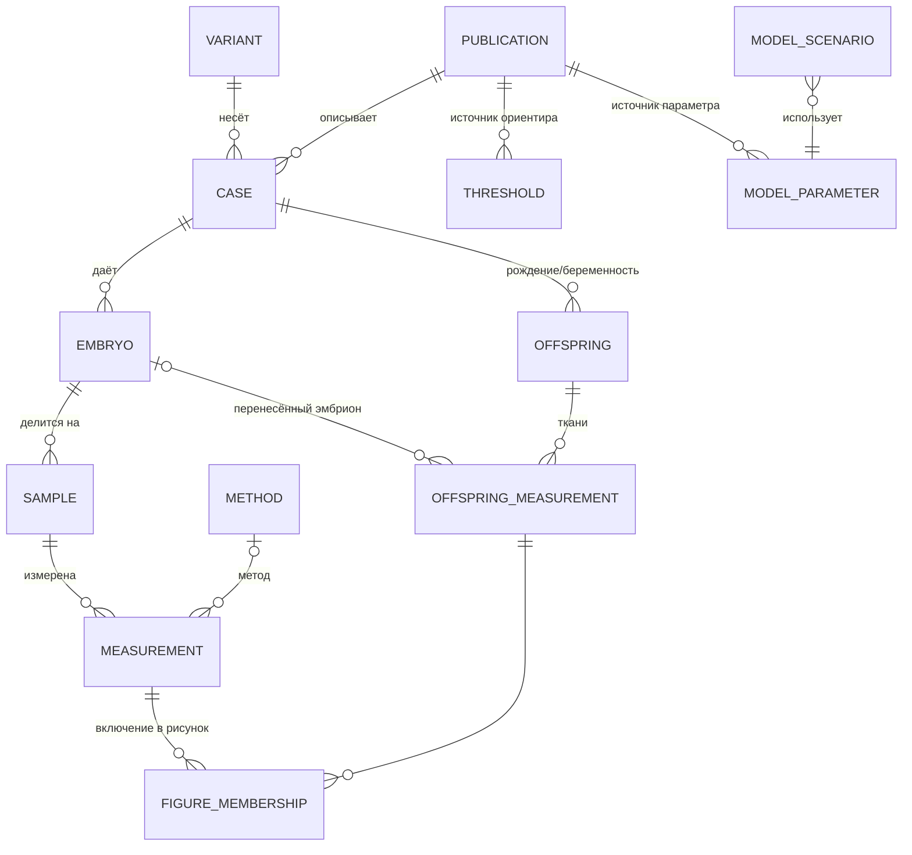

# PGT-mt Atlas — план реализации

*Версия 0.2 · 10.10.2026 (v0.2: статус Tofilo et al. 2026, сверка с ESM, ход реализации — раздел 9)*
*Основан на аудите `docs/data_inventory.md`; ссылки вида «инв. 5.1» ведут на его разделы.*

---

## 0. Цель и принципы

**PGT-mt Atlas** — двуязычный (EN/RU) научный сайт с интерактивной базой опубликованных индивидуальных значений гетероплазмии мтДНК при ПГТ-мт. В основе — набор данных обзора Тофило и Мазунина (Acta Naturae).

Принципы обязательны для всех этапов:

1. **Исходные данные неизменны.** `data/Сопроводительная информация.xlsx` читается только на чтение. Всё, что видит сайт, получается детерминированным конвейером из этого файла и из явно записанных кураторских метаданных. Контрольная сумма исходника фиксируется в каждом выпуске данных.
2. **Ничего не дополняем.** Отсутствующие DOI, значения, ткани, возраст и исходы остаются пустыми (`null`) с пометкой «не сообщается в источнике». Номера ссылок, DOI и статусы публикаций берутся из рукописи и PDF, а не подбираются.
3. **Наблюдения отдельно от модели.** Наблюдаемые значения (рис. 3–5) и сценарный расчёт (рис. 6) хранятся в разных сущностях, выгружаются разными файлами и в интерфейсе различаются цветом, значком и текстом («Наблюдаемые данные» / «Модельный расчёт»).
4. **Прослеживаемость каждого числа:** точка на графике → запись базы → строка и столбец xlsx → публикация (DOI) → место в публикации (текст, таблица, приложение, рисунок).
5. **Воспроизводимость обзора.** Сайт по умолчанию показывает рисунки ровно так, как в статье (те же выборки и исключения). Дополнительные фильтры — поверх, с явной пометкой «вне рисунка статьи».
6. **Без публикации.** Сайт не публикуется, репозиторий остаётся приватным, пока авторы явно не разрешат (раздел 7).

---

## 1. Нормализованная база данных

### 1.1. Модель сущностей



Сущности `MODEL_*` образуют отдельное пространство «модель». Наблюдения из них никогда не выводятся.

### 1.2. Таблицы и поля

Типы: `id` — стабильный строковый ключ; `pct` — число 0–100 или `null`; `enum` — код из контролируемого словаря (1.4). У каждой таблицы наблюдений есть поля **провенанса**: `src_sheet`, `src_row`, `src_cols` и `value_origin` (где в первоисточнике взято значение).

**`publication`** — первичные и вторичные источники.

| Поле | Тип | Примечание |
|---|---|---|
| `publication_id` | id | `spath2021`, `tofilo2026`, `thorburn2009` |
| `authors_short`, `year`, `journal`, `title` | text | из списка литературы рукописи |
| `doi` | text \| null | **только** подтверждённый (из списка литературы рукописи); Tofilo 2026 — `10.1007/s10815-026-04012-y` (подтверждено PubMed, статус `published`); Thorburn — `null` |
| `pmid` | text \| null | заполняется позже по DOI (сверка, а не подбор) |
| `pub_status` | enum | `published`, `in_press`, `conference_abstract`, `preprint` |
| `review_ref_no` | int \| null | номер в списке литературы обзора (а не номера из xlsx — инв. 5.2) |
| `data_access_note` | text | например, «значения по обзорам [12, 13]» |

**`variant`**

| Поле | Тип | Примечание |
|---|---|---|
| `variant_id` | id | HGVS-подобная запись как в источнике: `m.3243A>G` |
| `variant_class` | enum | `pathogenic`, `uncertain_significance` (m.3250T>C — так в рукописи), `neutral_polymorphism` (HV2) |
| `gene` | text \| null | заполняется только со ссылкой на источник (рукопись или PDF) |
| `phenotypes_raw` | text | из «Таблица 1»!B без изменений |

**`case`** — пациентка (семья) или цикл внутри публикации.

| Поле | Тип | Примечание |
|---|---|---|
| `case_id` | id | `spath2021_patientB`; если источник не различает пациенток — один case на публикацию и вариант |
| `publication_id`, `variant_id` | FK | |
| `label_in_source` | text \| null | «patient B», «пациентка 2» |
| `data_type` | enum | `individual`, `aggregated` («Таблица 1»!G) |
| `maternal_tissues` | json \| null | только если есть в xlsx (Hu 2026: кровь 20,2%, моча 21,7%, буккальный эпителий 27,9%) |
| `table1_row` | int \| null | ссылка на строку «Таблица 1» |
| `pool_range_raw`, `transferred_raw`, `offspring_raw` | text | текстовые поля «Таблица 1» без изменений |

**`embryo`**

| Поле | Тип | Примечание |
|---|---|---|
| `embryo_id` | id | генерируется из листа и строки (`fig3_r045`) или из ID источника (`Tofilo_1`, `Monnot2011_P2_emb12`) |
| `case_id` | FK | |
| `label_in_source` | text \| null | `E6`, `emb17`, `Day5 4AB` |
| `stage` | enum | `zygote`, `cleavage`, `morula`, `blastocyst`, `arrested`, `unknown` |
| `stage_raw` | text | исходная строка без изменений |
| `transferred` | bool \| null | только если указано |
| `pgta_result_raw` | text \| null | только если указано (Hu 2026: euploid / aneuploid / mosaic) |

> Эмбрионы из разных листов (например, Treff в «Рисунок 3» и «Рисунок 4») в xlsx не связаны общими ID. **Автоматически не объединяем.** Поле `same_as` заполняется только после подтверждения авторами.

**`sample`** — исследованный материал эмбриона.

| Поле | Тип | Примечание |
|---|---|---|
| `sample_id`, `embryo_id` | id, FK | |
| `sample_type` | enum | `single_blastomere`, `two_blastomeres`, `multiple_blastomeres`, `te_biopsy`, `icm`, `remaining_te`, `mixed_te_icm`, `whole_embryo`, `half_embryo`, `embryo_sample_unspecified` |
| `material_raw` | text | исходная строка |
| `n_cells_raw` | text \| null | `'3–5'` хранится как текст |

**`measurement`** — значение гетероплазмии в эмбриональном материале.

| Поле | Тип | Примечание |
|---|---|---|
| `measurement_id`, `sample_id` | id, FK | |
| `value_pct` | pct | точное значение, если опубликовано |
| `qualifier` | enum | `exact`, `not_detected` (0 в xlsx), `less_than`, `interval`, `approximate` |
| `value_low_pct`, `value_high_pct` | pct | для интервалов (Mizuguchi 26–45, 84–88); середина **не вычисляется** |
| `lod_pct` | pct \| null | только если указан (Hu 1,0; Monnot 2) |
| `derivation` | enum | `as_reported`, `mean_of_blastomeres`, `mean_of_halves`, `mean_of_biopsies`, `mean_of_double_transfer`, `digitized_from_figure`, `via_secondary_review`, `as_reported_in_dataset` (правило не записано) |
| `value_origin` | enum | `text`, `table`, `supplement`, `figure`, `secondary_review`, `own_data` |
| `method_id` | FK \| null | |
| `note_raw` | text \| null | «Рисунок 3»!I и подобные |
| `src_sheet`, `src_row`, `src_cols` | provenance | |

**`method`** — `method_id`, `name_raw`, `platform` (enum: `ngs`, `qpcr`, `arms_qpcr`, `pyrosequencing`, `pcr_rflp`, `ddpcr`, `wgs`, `unknown`), `wga` (bool \| null), `lod_pct` (\| null). Заполняется **только** тем, что есть в xlsx (сейчас — для C5 и C14) или подтверждено куратором по тексту источника с указанием страницы.

**`offspring`** — ребёнок или беременность: `child_id` (= код случая C1…C14), `case_id`, `outcome_raw`.

**`offspring_measurement`** — одно сопоставление «эмбрион — ткань» (строка «Рисунок 5»).

| Поле | Тип | Примечание |
|---|---|---|
| `pair_id` | id | `C5e` (как в xlsx и подписях рисунка) |
| `child_id` | FK | |
| `embryo_value_pct`, `embryo_qualifier` | pct, enum | значение перенесённого эмбриона, как в листе |
| `embryo_id` | FK \| null | только при однозначной связи |
| `phase` | enum | `prenatal`, `postnatal` |
| `tissue` | enum | `amniotic_fluid`, `placenta`, `fetal_tissue`, `cord_blood`, `blood`, `urine`, `buccal`, `cvs`, `unspecified` |
| `tissue_raw` | text | исходная строка |
| `value_pct`, `qualifier` | pct, enum | C5d: `less_than` 10 |
| `age_raw`, `method_raw` | text \| null | |
| `delta_pp` | вычисляемое | ткань − эмбрион; считается ETL |

**`analysis_membership`** — воспроизводимое описание выборок рисунков статьи.

| Поле | Тип | Примечание |
|---|---|---|
| `figure`, `panel` | text | `fig3`, `fig4A`, `fig4C`, `fig5A` … |
| `record_type`, `record_id` | text | `measurement` / `offspring_measurement` / `cleavage_pair` |
| `included` | bool | |
| `exclusion_reason` | text \| null | из листа: «двойной перенос», «цензурировано», «ткань не указана» |
| `display_group` | text | блок или столбец на рисунке (вариант, источник) |

**`threshold`** — ориентиры: 18% [11], 15–30% [10], 30% [22], 1% (условный предел обнаружения), 70% (условная высокая нагрузка). Поля: `value` или `range`, `meaning_ru/en`, `publication_id` \| null, `is_clinical_threshold = false` для всех.

**Пространство «модель»** (только рис. 6):

* `model_definition` — `formula` (`p_both = p_het × p_eupl`; `P = 1 − (1 − p_both)^N`), `assumptions[]` (независимость гетероплазмии и плоидности; независимость бластоцист; внутрисемейная корреляция не учтена), `not_individual_risk = true`.
* `model_parameter` — `p_eupl` по возрасту (30 → 0,7; 35 → 0,5; 40 → 0,3), `publication_id = volodyaev2025`, `locator` (таблица или страница — вопрос В6).
* `p_het` в базе **не хранится**: он вычисляется на лету из `measurement` + `analysis_membership(landscape)` при выбранной границе. Так модель всегда согласована с наблюдениями.

**Служебные:** `vocab` (код, `label_ru`, `label_en`, определение) и `dataset_release` (версия, дата, коммит, SHA-256 исходного xlsx, счётчики, список изменений).

**`verification`** (добавлено в v0.2) — автоматическая сверка значений набора с опубликованными дополнительными материалами: `publication`, `embryo`, `esm_fraction`, `esm_value`, `dataset_value`, `status` (`match` / `value_mismatch` / `fraction_label_mismatch` / `not_in_dataset`), комментарий RU/EN. Сейчас сверяется Tofilo et al. 2026 с ESM 2. Расхождения **не исправляют** набор: они показываются в карточках наблюдений и на странице источников, решение — за авторами.

### 1.3. Отображение листов xlsx на таблицы

| Лист | → Таблицы |
|---|---|
| Таблица 1 | `publication`, `case` (текстовые поля), `variant.phenotypes_raw` |
| Рисунок 3 | `embryo`, `sample`, `measurement` (187), `analysis_membership(landscape)` |
| Рисунок 4 (А) | `embryo` (40), `sample` (фракции), `measurement` (91), `analysis_membership(concordance)`; лист панели Б — только для сверки |
| Бластомеры (дробление) | `embryo` (22), `sample` ×2, `measurement` ×2, `analysis_membership(cleavage-concordance)` |
| Рисунок 5 | `offspring`, `offspring_measurement` (23 + C13), `analysis_membership(offspring)` |
| Рисунок 6 | только для сверки; модель строится из `model_*` + рис. 3 |
| Hu 2026 (16 проб) | `embryo` (1), `sample` (16), `measurement` (16), membership `text_only` |
| Tajima 2007 | `measurement` с `included=false` и причиной из листа |

### 1.4. Словари и двуязычие

Контролируемые словари (`etl/vocab.yaml`) сопоставляют 35 исходных строк стадии и 23 строки материала с кодами `stage` и `sample_type`. Пример: `'TE biopsy (3–5 cells)'` → `te_biopsy`, `n_cells_raw='3–5'`. Каждая исходная строка должна иметь явное сопоставление, иначе ETL падает. Подписи кодов: `label_ru` / `label_en` (ТЭ / TE, ВКМ / ICM, п.п. / pp, оставшаяся ТЭ / remaining TE).

### 1.5. Форматы выгрузки

* `site/public/data/atlas.json` — вся база для сайта (оценка: < 150 КБ).
* `site/public/data/csv/*.csv` — по таблице на сущность. Плюс плоские `observations_embryo.csv` (187 + …) и `observations_offspring.csv` (22 + исключённые). Модель в CSV **не выгружается**: она доступна только как калькулятор с формулой.
* `schema/atlas.schema.json` (JSON Schema). Из неё генерируются TypeScript-типы (`json-schema-to-typescript`). Сайт и ETL используют одну схему.
* `CITATION.cff` и `data/README` с лицензией — после ответа на В3.

---

## 2. Конвейер данных (ETL)

**Язык — Python 3.12**: существующие скрипты и openpyxl уже на Python, и логику отбора рисунков удобно переносить один в один.

```
etl/
  pyproject.toml            openpyxl, pydantic, pyyaml, pytest
  atlas_etl/
    read_xlsx.py            чтение листов по явным диапазонам; формулы игнорируются
    normalize.py            листы → сущности 1.2
    vocab.yaml              словари стадий, материалов, тканей (RU/EN)
    curation/
      publications.yaml     метаданные публикаций из списка литературы рукописи
      figure_rules.yaml     правила выборок рисунков (перенос BLOCKS/исключений из скриптов)
    derive.py               Δ, размахи, медианы, доли ≤ границы (вместо формул без кэша)
    validate.py             JSON Schema + бизнес-правила
    export.py               JSON / CSV / manifest
  tests/
    test_golden.py          воспроизведение раздела 3 инвентаря
    test_source_unchanged.py
```

**Проверки (CI падает при нарушении):**

* *Эталонные тесты:* 187 значений; по вариантам 87 / 28 / 26 / 21 / 9 / 8 / 8; доли 41/87, 52/87, 6/28, 8/28, 1/21, 3/21, 24/26, 5/9, 93/187; 40 бластоцист (21 + 19); медианы 2,1 / 1,0 / 1,17; 22 эмбриона дробления (медиана 1, максимум 6); 22 пары и 8 детей; 16 из 20 согласованных; P = 0,235 / 0,552 / 0,800.
* *Целостность:* значения в [0, 100]; интервал `low ≤ high`; у каждой записи есть публикация; DOI либо `null`, либо в формате `10.\d+/…`; у каждой исходной строки словаря есть сопоставление.
* *Неизменность исходника:* SHA-256 xlsx сверяется с `data/SOURCE_MANIFEST.sha256`. Изменение исходника допускается только в PR с меткой `data-change`, а отчёт о различиях (какие строки добавлены или изменены) публикуется в PR автоматически.
* *Сверка DOI* (не блокирующая, еженедельно): запрос метаданных Crossref по каждому DOI и сравнение года, журнала и первого автора с `publications.yaml`. Расхождения оформляются как issue, автоматических исправлений нет.

---

## 3. Архитектура сайта

### 3.1. Стек

| Слой | Выбор | Обоснование |
|---|---|---|
| Сборка | **Vite 5** + TypeScript (strict) | быстрая статическая сборка под GitHub Pages |
| UI | **React 18** | требование |
| Маршрутизация и пререндер | React Router 6 + `vite-react-ssg` (статический HTML для каждой страницы и языка) | индексируемость научного раздела, работа без JS для текстов; запасной вариант — HashRouter |
| Графики | **Plotly.js** через `react-plotly.js/factory` + частичная сборка (`plotly.js-basic-dist-min` или своя: scatter, box) | ~1 МБ вместо 3,5 МБ; ленивая загрузка только на страницах рисунков; встроенный экспорт PNG/SVG |
| i18n | `react-i18next` (интерфейс) + MDX-файлы (длинные тексты) по языкам; `Intl.NumberFormat` (RU: «0,47», EN: «0.47»); локаль Plotly `ru` | |
| Таблицы | TanStack Table (сортировка, фильтры, экспорт видимого набора в CSV) | |
| Стили | CSS Modules + CSS-переменные (светлая и тёмная темы); палитра, различимая при дальтонизме; формы маркеров дублируют цвет | |
| Тесты | Vitest (формулы, доли, i18n-ключи), Playwright (обе локали, все рисунки строятся, нет ошибок в консоли), axe-core (доступность) | |

### 3.2. Маршруты и разделы

```
/{en|ru}/                          Главная: что такое атлас, 3 ключевых числа, два входа — «Учёным» и «Пациентам»
/{lang}/science/                   Научный раздел
    /data                          Обозреватель данных: таблица всех наблюдений, фильтры, карточка записи, CSV
    /between-embryos               Рис. 3 (интерактивный)
    /within-embryo                 Рис. 4
    /embryo-to-offspring           Рис. 5
    /pgt-mt-and-pgt-a              Рис. 6 — МОДЕЛЬ (отдельная цветовая схема и баннер)
    /cases                         Расширенная таблица 1 (фильтр «как в статье» / «все 30 строк»)
    /sources                       Публикации: статус, DOI, что взято, откуда (текст, таблица, рисунок)
    /methods                       Критерии включения, правила вывода значений, ограничения, «минимальный набор данных»
    /changelog                     Выпуски данных
/{lang}/patients/                  Раздел для пациентов (3.4)
/{lang}/about                      Авторы, конфликт интересов, как цитировать, лицензия, контакты
```

Переключатель языка сохраняет текущую страницу. Язык по умолчанию определяется по `navigator.language` и запоминается.

### 3.3. Интерактивные рисунки (научный раздел)

Общее для всех рисунков: режим «Как в статье» (по умолчанию) и «Исследовать»; подсказка у каждой точки (значение, квалификатор, источник со ссылкой на DOI, стадия и материал в исходной формулировке, способ получения значения, строка xlsx); таблица данных под графиком; выгрузка видимых данных (CSV) и изображения (PNG/SVG); постоянная ссылка на состояние фильтров через query-параметры; текстовая альтернатива для экранных чтецов.

| Рисунок | Представление | Управление | Особые правила |
|---|---|---|---|
| **3** | Точечная диаграмма с детерминированным разнесением точек (порт `place()` из `Рисунок_3.py`), x = вариант → источник; интервалы — вертикальные отрезки; полосы и линии ориентиров — Plotly shapes | вариант, источник, стадия, тип материала, производные значения (показывать / выделять); граница для подсчёта долей: 18 / 30 (+ ползунок в режиме «Исследовать» с подписью «вне статьи»); «объединять ≥6 совпадающих» | Доли пересчитываются из базы; интервал засчитывается только по верхней границе; «0» в подсказке = «не выявлено (предел …)»; ни одна линия не подписывается как «безопасный порог» |
| **4** | А — линии «фракция → фракция» по эмбриону; Б — разности по группам; В — размахи + медиана | патогенные / HV2; источник; вариант; подсветка эмбриона на всех трёх панелях | Δ и размахи вычисляются из А; полосы ±5 п.п. подписаны как «порядок методической погрешности»; Hu 2026 (16 проб) — отдельная вкладка «Пояснительные данные, вне рисунка» |
| **5** | А — эмбрион против ткани, линия y = x, точки одного ребёнка связаны; Б — Δ по категориям материала | группировка и выделение ребёнка; этап; ткань; «показать исключённые» (C5d — маркер «<10%» со стрелкой вниз; C13 и не включённые случаи — список с причинами, без точек) | Счётчик всегда «N пар / M детей»; предупреждение о зависимости пар (7 из 22 — один ребёнок) |
| **6** | Кривые P(≥1) от N; панели по возрасту или выбранный сценарий | вариант(ы); граница 18 / 30; p_эупл: 0,7 / 0,5 / 0,3 (как в статье; шире — только после решения В6); N = 1–8 | Баннер «Модельный расчёт, не индивидуальный прогноз»; p_гет показан как «k/n из рис. 3», при n < 10 — пометка о малом n; формула и допущения раскрыты под графиком; в пациентский раздел калькулятор не переносится |

Опционально, только по решению авторов: доверительные интервалы для p_гет (например, Вильсона) на рис. 6. Это **новая статистика сверх статьи**, поэтому по умолчанию она не включается.

### 3.4. Раздел для пациентов

Цель — объяснить, а не прогнозировать. Тексты пишутся отдельно, а не сокращаются из научных.

* Страницы: «Что такое мтДНК и гетероплазмия» · «Что делает ПГТ-мт и чего он не делает» · «Почему процент — не диагноз» (ранжирование эмбрионов; нет универсального безопасного порога) · «ПГТ-мт и проверка хромосом (ПГТ-А)» · «Какие есть варианты» (ПГТ-мт, пренатальная диагностика, донорские ооциты, митохондриальная донация — без сравнения эффективности сверх рукописи) · «Вопросы, которые стоит обсудить с генетиком» · глоссарий.
* Иллюстрации: статичные схемы на основе рис. 1–2 и одна упрощённая версия рис. 3 с объяснением «каждая точка — эмбрион из опубликованной работы». Без интерактивного расчёта вероятностей.
* На каждой странице: «Информация не заменяет консультацию врача-генетика»; ссылка «Подробнее для специалистов».
* Требования к текстам: простой язык (целевой уровень — понятный старшекласснику), определение каждого термина при первом упоминании, никаких обещаний исхода. Публикация — только после проверки медицинским генетиком (В8).

### 3.5. Структура репозитория (целевая)

```
data/                         исходный xlsx (только чтение) + SOURCE_MANIFEST.sha256
docs/                         рукопись, data_inventory.md, implementation_plan.md
figures/originals/            без изменений
references/                   без изменений, в сборку сайта НЕ попадает
etl/                          раздел 2
schema/atlas.schema.json
site/
  package.json, vite.config.ts (base: '/pgt-mt-atlas/')
  src/
    app/ routes/ components/ figures/{Fig3,Fig4,Fig5,Fig6}/ model/ (чистые функции рис. 6)
    data/ (загрузка atlas.json, селекторы — те же правила, что в ETL)
    i18n/{en,ru}/*.json
  content/{en,ru}/{science,patients,about}/*.mdx
  public/data/                генерируется ETL, коммитится через PR (виден diff)
.github/workflows/            раздел 4
```

---

## 4. Еженедельное обновление и CI/CD

| Workflow | Триггер | Что делает | Права |
|---|---|---|---|
| `ci.yml` | push, PR | ETL + эталонные тесты; lint, typecheck, Vitest; сборка сайта; Playwright на собранной версии; артефакт `site-dist` (для локального просмотра, **без публикации**) | read |
| `weekly-data.yml` | `cron: '17 6 * * 1'` (пн, 06:17 UTC) + ручной запуск | Перегенерирует данные из текущего xlsx. Если выгрузка изменилась — открывает PR «Data release YYYY-MM-DD» с отчётом о различиях (добавленные и изменённые записи, изменения долей). **Автослияния нет.** | contents: write, pull-requests: write |
| `literature-watch.yml` | еженедельно | Запрос PubMed E-utilities (PGT-mt, preimplantation + mtDNA heteroplasmy и т. п.) и Crossref-сверка DOI. Новые кандидаты публикуются в issue «Literature watch» для куратора. **Значения в базу автоматически не попадают никогда.** | issues: write |
| `deploy-pages.yml` | только `workflow_dispatch` | Сборка и `actions/deploy-pages`. Окружение `github-pages` с обязательным ревьюером; job выполняется только при переменной репозитория `PAGES_ENABLED == 'true'` (сейчас не задана) | pages: write, id-token: write |

**Процесс обновления данных:** куратор правит xlsx (или, на будущем этапе, CSV-файлы курации) в ветке → PR с меткой `data-change` → CI показывает отчёт о различиях и проверяет правила → научное ревью авторов → слияние → еженедельный выпуск получает версию `YYYY.MM.DD`, запись в `/changelog` и SHA-256 исходника.

---

## 5. Этапы и критерии приёмки

| Этап | Содержание | Критерий готовности |
|---|---|---|
| **0. Аудит и план** (эта сессия) | `data_inventory.md`, `implementation_plan.md` | Согласование авторами |
| **1. Фундамент данных** | `etl/`, словари, `publications.yaml`, схема, выгрузки | Все эталонные тесты зелёные; ни одного поля, заполненного без источника; отчёт о покрытии провенансом 100% |
| **2. Каркас сайта** | Vite/React/TS, маршруты, i18n, макет, CI без деплоя | Сборка в CI; обе локали; Lighthouse ≥ 90 (производительность и доступность) на главной |
| **3. Рисунки 3–6** | Интерактивные версии + таблицы + выгрузки | Режим «Как в статье» визуально и численно совпадает с TIF (доли, n, медианы, кривые); Playwright-тесты |
| **4. Тексты** | Научные страницы (методы, источники, ограничения) EN/RU; пациентский раздел — черновик | Вычитка авторами; пациентский раздел проверен генетиком |
| **5. Автоматизация** | `weekly-data`, `literature-watch`, сверка DOI | Пробный еженедельный прогон открывает корректный PR и issue |
| **6. Предпубликационная проверка** | Доступность, лицензия, юридический текст, финальное согласие | Явное разрешение авторов на публикацию → решение по разделу 7 |

---

## 6. Риски

| Риск | Мера |
|---|---|
| Сайт воспринят как инструмент индивидуального прогноза | Модель только в научном разделе, баннеры, без калькулятора для пациентов, формулировки из рукописи («не мета-анализ», «не задаёт безопасного порога») |
| Данные до выхода обзора; расхождения набора с опубликованными ESM (Tofilo 2026, инв. 7) | Решение В2 до любой публикации; таблица `verification` и пометки в карточках наблюдений; исходник правят только авторы (В9, В10) |
| Ошибка переноса логики из matplotlib-скриптов | Эталонные тесты по числам рукописи; визуальная сверка с TIF |
| Расхождения DOI и нумерации ссылок (инв. 5.1, 5.2) | Ссылки только по `publication_id`; номера — из рукописи; Crossref-сверка |
| Размер бандла Plotly | Частичная сборка, ленивая загрузка, пререндер текстов |
| Расширение набора новыми статьями | Только через ручную курацию и PR; literature-watch лишь предлагает кандидатов |

---

## 7. Ограничения публикации (сейчас ничего не публикуется)

* Репозиторий остаётся **приватным**. Workflow деплоя создаётся отключённым (раздел 4).
* GitHub Pages для приватного репозитория требует платного плана. При этом **сам сайт будет общедоступным** (закрытый доступ к Pages есть только в GitHub Enterprise Cloud). Поэтому включение Pages — отдельное решение авторов. Альтернатива для внутреннего просмотра — артефакт сборки CI, открываемый локально.
* В сборку сайта никогда не попадают `references/` (авторское право; там же ранняя рукопись Tofilo 2026 и ESM) и, до выхода статьи, `docs/*.docx`.

---

## 8. Что нужно от авторов для старта этапа 1

1. Согласование этого плана (или правки).
2. Ответы на вопросы **В2–В10** из `data_inventory.md` (раздел 6; В1 закрыт). Для данных важны В4, В5, В9 и В10; для рисунка 6 — В6; для публикации — В2, В3 и В8.
3. Подтверждение, что источником истины на этапе 1 остаётся xlsx (переход на CSV-курацию — позже и по решению авторов).

---

## 9. Ход реализации (v0.2, 10.10.2026)

| Этап | Статус | Что сделано |
|---|---|---|
| 1. Фундамент данных | ✅ | `etl/`: чтение xlsx, словари RU/EN, кураторские `publications.yaml` и `rules.yaml`, генерация библиографии из рукописи, нормализованные CSV (8 таблиц), `atlas.json`, манифест SHA-256, 10 эталонных тестов (все числа обзора воспроизводятся), сверка Tofilo 2026 с ESM 2 |
| 2. Каркас сайта | ✅ | Vite 8 + React 19 + TypeScript (strict), статическая генерация 25 страниц (EN/RU), переключатель языка с сохранением раздела, светлая/тёмная тема, баннер «предварительная версия», `noindex` |
| 3. Рисунки 3–6 | ✅ (первая версия) | Интерактивные рис. 3–6 с режимом «Как в статье», карточками происхождения, таблицами и выгрузкой CSV; рис. 6 — отдельный модуль `site/src/model/` и значок «Модельный расчёт» |
| 4. Тексты | 🟡 черновик | Методы и ограничения, источники, «О проекте»; пациентский раздел — черновик с пометкой, требует проверки генетиком (В8) |
| 5. Автоматизация | 🟡 | `ci.yml`, `weekly-data.yml`, `literature-watch.yml` написаны; пробный прогон — после того как workflow окажутся в GitHub |
| 6. Предпубликационная проверка | ⏸ | `deploy-pages.yml` создан выключенным (`PAGES_ENABLED` не задана) |

**Отступления от плана (технические, на согласование):**

* React Router 6, а не 7: генератор статических страниц `vite-react-ssg` пока поддерживает только 6-ю версию.
* Длинные тексты хранятся в компонентах TSX по языкам, а не в MDX: меньше зависимостей; при росте объёма текстов можно перейти на MDX.
* По экземпляру i18next на язык (вместо одного с переключением): страницы двух языков рендерятся последовательно при статической генерации.
* Палитра рис. 5: цвет кодирует **вариант** (3 цвета + нейтральный для m.3697G>A), а не ребёнка (8 цветов, как в TIF). Восемь цветов на точечном графике не различимы при нарушениях цветового зрения (проверено валидатором палитры). Ребёнок обозначен подписями случаев, линией C5 и подсказками.
* Рис. 3: точки разнесены по упрощённому детерминированному алгоритму в единицах данных (в TIF — в дюймах). Числа, n и доли совпадают; расположение отдельных точек может отличаться.
* Таблица 1: фильтр «как в статье» не реализован — по xlsx нельзя однозначно сопоставить 30 строк расширенной таблицы с 17 строками таблицы в рукописи.
* Метаданные Tofilo 2026 подтверждены по PubMed: страница Springer недоступна из окружения сборки (сетевая политика).

